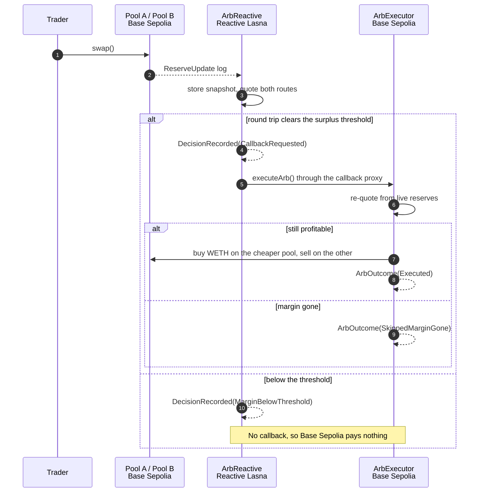
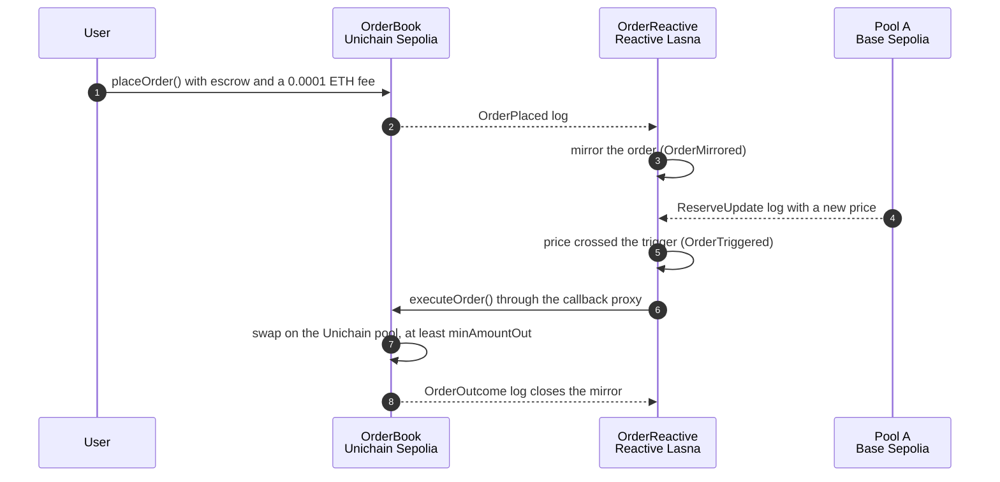

# Nervo

[](https://github.com/zakyirsyaad/reactive-hackaton/actions/workflows/ci.yml)
[](https://github.com/zakyirsyaad/reactive-hackaton/actions/workflows/security.yml)
[](https://github.com/zakyirsyaad/reactive-hackaton/actions/workflows/onchain.yml)

**One reactive loop, two uses: cross-chain arbitrage on Base Sepolia and stop-loss orders on Unichain Sepolia that react to the Base price. Decided on Reactive Lasna in under two seconds, with no off-chain bot.**

Entry for the **Every Second Counts** track of the [Reactive Omni Buildathon](https://dorahacks.io/hackathon/reactive-omni-buildathon/detail).

A swap on one of two WETH/USDC pools on Base Sepolia opens a price gap. A Reactive contract on Lasna sees the pool event, quotes the round trip in both directions, and requests a callback only when the gap clears a 2 USDC surplus. An executor on Base Sepolia re-checks the quote against live reserves and either trades both legs atomically or records why it skipped. Both decisions are on-chain events you can audit.

The same loop also protects positions. A user places a stop-loss, take-profit or limit buy on Unichain Sepolia; a second Reactive contract mirrors the order book from its events, watches the price on Base Sepolia, and makes the order book execute the order on Unichain within about two seconds of the trigger. No keeper or server watches the price.

| | |
|---|---|
| Median latency, swap to callback | **1.6 s** (p95 2.0 s, 73 of 73 callbacks arrived) |
| Destination fees saved by filtering on Lasna | **56%**, with the same 3 trades executed |
| Protective orders, trigger to fill | **1.8 s** median over 40 stop-losses (p95 2.8 s, 40 of 40 filled) on Unichain, triggered by the Base price ([details](#protective-orders)) |
| Contracts | 4 core contracts, 3 test fixtures, 157 Foundry tests including invariants |
| Web app | Live prices, swap, protective orders, faucets, and trackers that follow each loop across chains ([web/](web/)) |

## Contents

- [Who it is for](#who-it-is-for)
- [How it works](#how-it-works)
- [Protective orders](#protective-orders)
- [Why it needs Reactive](#why-it-needs-reactive)
- [Results](#results)
- [On-chain proof](#on-chain-proof)
- [Deployed contracts](#deployed-contracts)
- [Safety](#safety)
- [Repository layout](#repository-layout)
- [Run it yourself](#run-it-yourself)
- [Limitations](#limitations)

## Who it is for

**Someone holding WETH on Unichain who wants a stop-loss that still fires while they are offline.** Today that takes a bot, a process that watches the price around the clock and holds a key that can sign on Unichain, or a keeper service trusted with that job. Here the order sits in a contract on Unichain, a Reactive contract on Lasna watches the price, and nothing runs on the user's side after they place the order. On testnet, 40 of 40 stop-losses filled, 1.8 s at the median from the price crossing to the fill. The user pays a 0.0001 ETH fee per order; the Reactive contract spends about 0.07 lREACT on Lasna for it ([details](#protective-orders)).

**Why the trigger reads the Base price.** In our 72-hour mainnet replay, the busiest ETH/USDC pool on Unichain held about 13 times less liquidity than the Base pool, and a 1,000 USDC trade moved it by about 11 bps. A stop placed close to the price on a pool that thin can be set off by a single trade on that pool. Over the same 72 hours the Base and Unichain prices stayed within 1.6 bps of each other at the median, so the order follows the deeper market, which takes far more capital to move, and still trades on Unichain. `minAmountOut` sets the least the user accepts from that trade.

**Builders on Reactive.** Two results carry over to other projects. Deciding on Lasna before asking for a callback cut destination-chain fees by 56% with the same trades executed ([comparison](#filtering-on-lasna-versus-sending-every-candidate)). The replay shows that on Base a gap between two pools is closed inside the block that opened it, so a loop measured in seconds should not be built to race for it.

**Not for arbitrage profit.** On the mainnet markets we replayed, other traders closed almost every gap within a second. Across all of them, one gap was still open 2 seconds later, worth 0.86 USDC. The arbitrage half proves the mechanism and its latency, not a market edge ([replay](#would-it-pay-on-a-real-market)).

## How it works



1. Every reserve change on a pool emits `ReserveUpdate` with a per-pool sequence number and the source block timestamp.
2. `ArbReactive` subscribes to both pools. For each log it stores a snapshot, quotes a USDC → WETH → USDC round trip of 1,000 USDC in both directions with fees, and records exactly one `DecisionRecorded` event.
3. If the best route returns at least 1,000 + 2 USDC, it requests a callback carrying the opportunity id, route, input size, minimum surplus and a deadline.
4. `ArbExecutor` authenticates the callback, recomputes the quote from the reserves at execution time, and then either runs both swaps atomically or records a skip reason. Every callback ends in exactly one `ArbOutcome` event.

**Decisions on Lasna** (`ArbReactive.Decision`)

| Decision | Meaning |
|---|---|
| `CallbackRequested` | Best route clears the surplus threshold; a callback was requested |
| `MarginBelowThreshold` | Gap too small after fees; no callback |
| `ExecutorSwap` | The log came from our own executor's trade; snapshot updated only |
| `SnapshotIncomplete` | The other pool has not been seen yet |
| `SnapshotStale` | The other pool's snapshot is older than `MAX_SNAPSHOT_AGE` |
| `StaleOrDuplicateLog` | Sequence number not newer than the stored snapshot |
| `UnknownSource` | Log from a chain or contract the contract does not track |

**Outcomes on Base Sepolia** (`ArbExecutor.Outcome`)

| Outcome | Meaning |
|---|---|
| `Executed` | Both swaps ran and the surplus was kept |
| `SkippedMarginGone` | Prices moved before the callback arrived; nothing traded |
| `SkippedAlreadyExecuted` | This opportunity id was already executed |
| `SkippedExpired` | Callback arrived after its deadline |
| `SkippedInvalidRoute`, `SkippedInputOutOfBounds` | Request outside the executor's limits |
| `SkippedInsufficientInventory` | Executor holds less USDC than the input |
| `SwapReverted` | A swap reverted, or the realised surplus fell short; both legs rolled back |

## Protective orders

Arbitrage only pays if you beat other traders to a price gap, and the [market replay](#would-it-pay-on-a-real-market) shows that on Base and Unichain they close gaps within a second. A protective order has no race to win: the order is the user's own, and what matters is that it fires reliably within seconds of the price crossing, without a bot running somewhere. The same loop does that.



| Order | Escrow | Fires when the Base price is |
|---|---|---|
| Stop-loss | WETH | at or below the trigger |
| Take-profit | WETH | at or above the trigger |
| Limit buy | USDC | at or below the trigger |

**First order on testnet**, 17 November 2026: a stop-loss selling 0.1 WETH at a trigger of 3,300 USDC.

| Stage | Chain | Block | Transaction |
|---|---|---|---|
| `OrderPlaced` | Unichain Sepolia | 68055182 | [`0xe2fd4f04…adb1b1fa`](https://sepolia.uniscan.xyz/tx/0xe2fd4f048a4c02a1b702058ddd9621206de0ca27863b1b316ccd74c5adb1b1fa) |
| `OrderMirrored` (Open) | Lasna | 8560254 | [`0x8e075314…007541af`](https://lasna.reactscan.net/tx/0x8e07531459fbaded924fd0b9d72d541dc9df5c5de6b48f203b6a8c01007541af) |
| Swap drops Pool A to 3,272.72 | Base Sepolia | 59929137 | [`0x24fb6e5e…6f3b69d2`](https://sepolia.basescan.org/tx/0x24fb6e5e3602fc651f2795976b3b1668811d4fc8ade1d4f0008e4ca96f3b69d2) |
| `OrderTriggered` | Lasna | 8560332 | [`0x59637297…cc2cc5bd`](https://lasna.reactscan.net/tx/0x596372975f60279372d4553564566845653a5efa1409c2be8e368fc0cc2cc5bd) |
| `OrderOutcome` (Filled, 331.47 USDC) | Unichain Sepolia | 68055270 | [`0xf077bb61…ca504a59`](https://sepolia.uniscan.xyz/tx/0xf077bb612534f249fb02affb86c00295c292adb96a7b20e42673862fca504a59) |
| `OrderMirrored` (Closed) | Lasna | 8560334 | [`0x08b144ef…0ff18388`](https://lasna.reactscan.net/tx/0x08b144ef574ac574434e883203d20318d0cd527cffc51ba394e921c20ff18388) |

From the Base block that crossed the trigger to the Unichain block that filled the order: 1.8 s. Record: [evidence/order-2026-11-17.json](evidence/order-2026-11-17.json).

**Latency over 40 orders**, measured in two runs on 17 and 18 November 2026 (dates in UTC+7; the second run's block timestamps fall on 17 November UTC) with [tools/order_bench.py](tools/order_bench.py). Each sample places a 0.1 WETH stop-loss 0.4% below the Base Pool A price, waits until Lasna mirrors it, sells WETH on Pool A until the price is 0.6% lower, waits for the fill on Unichain, then restores the price. A 0.6% move stays below the arbitrage threshold, so the arbitrage loop does not interfere.

| Run | Orders | Filled | p50 | p95 | Min | Max |
|---|---|---|---|---|---|---|
| Both runs | 40 | 40 | 1,800 ms | 2,800 ms | 1,200 ms | 14,400 ms |
| 17 November | 10 | 10 | 1,800 ms | 2,600 ms | 1,200 ms | 2,600 ms |
| 18 November | 30 | 30 | 1,800 ms | 2,800 ms | 1,200 ms | 14,400 ms |

- Latency is the timestamp of the Unichain block that filled the order minus `blockTimestampMs` of the Base block that crossed the trigger. Unichain timestamps are whole seconds, so each value is a lower bound: the true delay is up to one second longer.
- 39 of the 40 orders filled within 2.8 s. The last sample of the 18 November run took 14.4 s. Lasna block timestamps are not used for any latency number, but they can still locate a delay: in the other 29 samples of the run they were within 1 s of the Base swap. In this sample Lasna recorded the trigger 12 s after the Base swap, and the callback to Unichain took 3 s as usual. The delay was in delivering the Base log to Lasna, not in the order book or the callback.
- Each order cost about 0.07 lREACT on Lasna (the order placement, the price update and the outcome each run `react()`), plus its 0.0001 ETH fee on Unichain. The 30-order run used 2.09 lREACT.
- Per-sample transactions on all three chains: [evidence/order-latency-2026-11-17.json](evidence/order-latency-2026-11-17.json) and [evidence/order-latency-2026-11-18.json](evidence/order-latency-2026-11-18.json).

**Built for strangers to use.** The order book is a public testnet contract, so it is hardened against griefing as well as theft:

- Each order prepays its own execution with a 0.0001 ETH fee, has a minimum size (0.001 WETH or 1 USDC), a non-zero `minAmountOut`, and a lifetime of at most 7 days.
- The Lasna mirror watches at most 64 orders, at most 4 per owner, evicts expired orders, stops after 5 trigger attempts or 3 slippage failures, re-arms a callback that is lost for 300 s, and rotates its scan so no order starves the others.
- Only the owner can cancel, and cancelling always refunds the escrow. The order book's owner can withdraw only callback funding, never escrow.
- An invariant suite feeds random order and price logs and checks that the mirror never tracks a dead order, never exceeds the per-owner cap, and never requests more than 5 callbacks for one order.

## Why it needs Reactive

A conventional arbitrage bot is a server that watches both pools, decides, and signs a transaction. Here there is no server: the subscription, the quote and the decision run in a contract on Lasna, and the network delivers the callback to Base Sepolia.

Doing the filtering on Lasna is also what makes it cheap. Lasna charges per log processed whether or not a callback follows, but the destination chain only pays for callbacks that are sent. The [comparison below](#filtering-on-lasna-versus-sending-every-candidate) measures that directly.

## Results

### Latency

From the block of the trigger swap to the block of the callback, both on Base Sepolia. Every callback the main stack requested from its deploy on 15 November to 17 November 2026 is included:

| Samples | Callbacks requested | Arrived | Timed out | p50 | p95 | Min | Max |
|---|---|---|---|---|---|---|---|
| All, 15 to 17 November | 73 | 73 | 0 | 1,600 ms | 2,000 ms | 800 ms | 3,600 ms |
| Benchmark run, 17 November | 50 | 50 | 0 | 1,600 ms | 2,000 ms | 800 ms | 3,200 ms |

- 63 samples come from [tools/bench_trader.py](tools/bench_trader.py), which sends one swap opening a 2% gap about every 18 seconds: 13 on 16 November and 50 in one run on 17 November. The other 10 come from swaps sent by the deployer wallet on 15, 16 and 17 November, including the demo scenarios.
- Outcomes: 71 `Executed`, 2 `SkippedMarginGone`. All 50 callbacks of the 17 November run were `Executed`.
- 71 of the 73 callbacks arrived within 2.0 s. The other two took 3.2 s and 3.6 s.
- Latency is the difference of `blockTimestampMs` between two Base Sepolia blocks, so both ends use the same chain's clock. Base Sepolia stamps blocks every 200 ms, which is the resolution of every number above. Lasna block timestamps are not comparable and are not used.
- `react()` cost about 0.049 lREACT per sample (three logs: the trigger swap and the executor's two swaps). The 50-sample run used 2.44 lREACT.

Per-sample data with the hashes of all three stages: [evidence/latency-2026-11-17.json](evidence/latency-2026-11-17.json). The earlier 12-sample result is kept in [evidence/latency-2026-11-16.json](evidence/latency-2026-11-16.json).

### Filtering on Lasna versus sending every candidate

A second stack runs the same contracts with `requestEveryCandidate` enabled: it requests a callback for every candidate and leaves all checking to the executor. Both stacks received the same workload on 16 November 2026: 3 rounds, each moving Pool B to a 0.5%, 1%, 1.3% and then 2% gap against Pool A. The first three gaps are below the 2 USDC threshold.

| 12 steps per stack | Filtered | No filter |
|---|---|---|
| Logs processed by `react()` | 18 | 18 |
| Callbacks requested | 3 | 12 |
| `Executed` | 3 | 3 |
| `SkippedMarginGone` (wasted callbacks) | 0 | 9 |
| Executor ETH spent on callbacks | 0.0000049 | 0.0000113 |
| lREACT spent on Lasna | 0.293 | 0.307 |
| Callback latency p50 / max | 1,800 / 2,000 ms | 1,600 / 2,000 ms |

- Both stacks executed the same three opportunities. Filtering removed nine callbacks that the executor skipped anyway, and cut destination ETH by 56%.
- A skipped callback is still billed, about 0.0000007 ETH; an executed one about 0.0000016 ETH.
- lREACT differs by only 5%. On Lasna the cost is dominated by `react()`, about 0.016 lREACT per log, which both stacks pay.
- The executor's re-check held for all nine unprofitable callbacks: inventory was untouched in every skip.

Run log with every step's hashes: [evidence/compare-run-2026-11-16.json](evidence/compare-run-2026-11-16.json). Computed report: [evidence/compare-2026-11-16.json](evidence/compare-2026-11-16.json).

### Would it pay on a real market?

Not on the markets we tested. We replayed 72 hours of mainnet swaps (11–13 November 2026), first between the two busiest pools of ten pairs on Base, then for ETH/USDC between Base and Unichain:

| Market | Episodes at about 0.10 USD threshold | Closed at once | Still viable at +2 s |
|---|---|---|---|
| WETH/USDC on Base, 1,000 USDC | 538 | 514 in the same block | 0 |
| Nine more pairs on Base (cbBTC, EURC, VIRTUAL, ZORA, MORPHO, AERO, DEGEN, BRETT), about 100 to 10,000 USD | 231 | 226 in the same block | 0 |
| ETH/USDC, Base against Unichain, 1,000 USDC | 150 | 108 at the same timestamp | 1, worth 0.86 USDC |

- **On one chain**, arbitrage is settled inside the block by searchers who trade right behind the swap that opened the gap. Long-tail pairs have wider, longer-lived gaps, but they stay inside the pools' combined fees (up to 125 bps), so there is nothing to trade.
- **Across chains**, where no one can settle both legs in one block, Base and Unichain still track each other within 1.6 bps at the median. The gap exceeded the combined fee for 0.08% of the time, and no gap lasted longer than 2 seconds.

A loop that acts 1.6 to 2 seconds after the signal cannot win these races. So the testnet results prove the mechanism, the integration and the latency, not a market edge. The same data shows why both halves of the design matter: the Lasna filter avoids paying for callbacks that would be rejected, and the executor's re-check stops a late callback from trading at a loss. Method, per-pair tables and assumptions: [replay/README.md](replay/README.md).

## On-chain proof

Three complete loops on testnet, one per possible ending. Base Sepolia hashes open on [sepolia.basescan.org](https://sepolia.basescan.org), Lasna hashes on [lasna.reactscan.net](https://lasna.reactscan.net).

**Opportunity holds.** Surplus 7.142010 USDC. The Lasna quote, the executor's re-quote and the realised output all equal 1,007.142010 USDC. Trigger block to callback block: 1.8 s.

| Stage | Chain | Block | Transaction |
|---|---|---|---|
| Trigger swap on Pool B | Base Sepolia | 59089529 | [`0x5be4c13e…cf0a3a46`](https://sepolia.basescan.org/tx/0x5be4c13e8e82050dabd132dcd60fd3e75b2803c409958a87f03175eacf0a3a46) |
| `CallbackRequested` | Lasna | 8402587 | [`0x695e4bf7…0e9a3a15`](https://lasna.reactscan.net/tx/0x695e4bf7030e53b168592b7c5c9ab8bee2058fee28e6846d8ef4fce30e9a3a15) |
| Callback, two swaps, `Executed` | Base Sepolia | 59089538 | [`0xe34f0e6d…6375be88`](https://sepolia.basescan.org/tx/0xe34f0e6d3be968c3a320f8fe64be21c96251c5c3519d6f5bd60ce1756375be88) |
| `ExecutorSwap` (Pool A) | Lasna | 8402589 | [`0xf9e7d1b5…2daada9f`](https://lasna.reactscan.net/tx/0xf9e7d1b518405cef996352d23425c09a3a005d73f2e6d86537c500102daada9f) |
| `ExecutorSwap` (Pool B) | Lasna | 8402589 | [`0x71e6e859…40ceb83f`](https://lasna.reactscan.net/tx/0x71e6e859bcd58d0b94ff9d9bfd055af7dff840ee4e42247d184b227d40ceb83f) |

**Opportunity gone before the callback.** The callback arrived and was skipped; executor inventory unchanged. Trigger block to callback block: 1.2 s.

| Stage | Chain | Block | Transaction |
|---|---|---|---|
| Swap opening a 2% gap | Base Sepolia | 59090298 | [`0x4db64309…f9c76290`](https://sepolia.basescan.org/tx/0x4db64309a8f23a16dca81249f51a9cea6b8cb90a80c3c7160d5cb2fcf9c76290) |
| Swap closing it back to 1% | Base Sepolia | 59090298 | [`0x2aadd9b9…8550b4dd`](https://sepolia.basescan.org/tx/0x2aadd9b9bd568759bc557adaf89a471aee63a7cd28f7b543b6c3700f8550b4dd) |
| `CallbackRequested` | Lasna | 8402733 | [`0x6b8ff7ea…a7efde97`](https://lasna.reactscan.net/tx/0x6b8ff7ea2a81af09dd6f8eaad8c1a29aa9a1f23afe9130a5a9ddc701a7efde97) |
| `MarginBelowThreshold` | Lasna | 8402733 | [`0x39ee49bb…4f7d0901`](https://lasna.reactscan.net/tx/0x39ee49bb1dd3eb3a08fdf70d2464a9703df2786cae4141119a7238d24f7d0901) |
| Callback, `SkippedMarginGone` | Base Sepolia | 59090304 | [`0xc0806ffd…7ff3642b`](https://sepolia.basescan.org/tx/0xc0806ffd315879e0351d8c8395155ab746c4fbd765fef4d8d121d8db7ff3642b) |

**Rejected on Lasna.** Quote 997.320839 USDC, below the threshold. No callback was requested and the executor was not touched.

| Stage | Chain | Block | Transaction |
|---|---|---|---|
| Swap opening a 1% gap | Base Sepolia | 59170842 | [`0xe8b48f47…f1eb0b36`](https://sepolia.basescan.org/tx/0xe8b48f477311a7ab0b2815ff8e480eb68da96ba366e01ea1e9dc01cdf1eb0b36) |
| `MarginBelowThreshold` | Lasna | 8417910 | [`0x2b13cbcd…5ee441aa`](https://lasna.reactscan.net/tx/0x2b13cbcd716892aae76d14bb1c124a321ae604d81dffcd7af4c1a5d55ee441aa) |

Raw event stream as seen by one observer: [evidence/observer-2026-11-15.jsonl](evidence/observer-2026-11-15.jsonl). What each evidence file contains: [evidence/README.md](evidence/README.md).

## Deployed contracts

**Main stack**, deployed 15 November 2026.

| Contract | Chain | Address |
|---|---|---|
| ArbReactive | Reactive Lasna (5318007) | [`0x0f70a79D1a0DFCB61005AF03084d3bED0e71E932`](https://lasna.reactscan.net/address/0x0f70a79D1a0DFCB61005AF03084d3bED0e71E932) |
| ArbExecutor | Base Sepolia (84532) | [`0xb568530a915a7Ae01FBE5917E1B21d666b24DFE4`](https://sepolia.basescan.org/address/0xb568530a915a7Ae01FBE5917E1B21d666b24DFE4) |
| Pool A | Base Sepolia | [`0x82DEA86F73edF0CC76cd2Ff4Ae8612380e63CE6F`](https://sepolia.basescan.org/address/0x82DEA86F73edF0CC76cd2Ff4Ae8612380e63CE6F) |
| Pool B | Base Sepolia | [`0xf68dE754214b013c206AFD5753b9f26428C29228`](https://sepolia.basescan.org/address/0xf68dE754214b013c206AFD5753b9f26428C29228) |
| Test WETH | Base Sepolia | [`0x29583A3d63FD02f1bE462d4b6A1B1BeCeFcaFB87`](https://sepolia.basescan.org/address/0x29583A3d63FD02f1bE462d4b6A1B1BeCeFcaFB87) |
| Test USDC | Base Sepolia | [`0xb790467931Ad6694747bB90c96ac9b07c0c4DE01`](https://sepolia.basescan.org/address/0xb790467931Ad6694747bB90c96ac9b07c0c4DE01) |
| Test token faucet | Base Sepolia | [`0xBba41830AfEbaDD7298BFC4B0E138c6c90c6D194`](https://sepolia.basescan.org/address/0xBba41830AfEbaDD7298BFC4B0E138c6c90c6D194) |

**No-filter comparison stack**, deployed 16 November 2026. It shares the test tokens with the main stack.

| Contract | Chain | Address |
|---|---|---|
| ArbReactive, `requestEveryCandidate` | Reactive Lasna | [`0x82DEA86F73edF0CC76cd2Ff4Ae8612380e63CE6F`](https://lasna.reactscan.net/address/0x82DEA86F73edF0CC76cd2Ff4Ae8612380e63CE6F) |
| ArbExecutor | Base Sepolia | [`0x9429334cBda1E85Cd99691aE4f0BBca2786d597C`](https://sepolia.basescan.org/address/0x9429334cBda1E85Cd99691aE4f0BBca2786d597C) |
| Pool A | Base Sepolia | [`0x97898610adD7F402C9D6612e5cF69e395eba7AC0`](https://sepolia.basescan.org/address/0x97898610adD7F402C9D6612e5cF69e395eba7AC0) |
| Pool B | Base Sepolia | [`0xE4140Ea6a6152F6F0cf02D13a56B7A7F60781105`](https://sepolia.basescan.org/address/0xE4140Ea6a6152F6F0cf02D13a56B7A7F60781105) |

The comparison stack's `ArbReactive` happens to share an address with the main stack's Pool A: they are on different chains, and both addresses come from the same deployer's nonces.

**Protective orders**, deployed 17 November 2026.

| Contract | Chain | Address |
|---|---|---|
| OrderReactive | Reactive Lasna (5318007) | [`0xc02a210DC8d74118205100Bb3744ed09d522fFCf`](https://lasna.reactscan.net/address/0xc02a210DC8d74118205100Bb3744ed09d522fFCf) |
| OrderBook | Unichain Sepolia (1301) | [`0x20eBb811ecD7198cAbB2D9293Ab13B94097DFe5b`](https://sepolia.uniscan.xyz/address/0x20eBb811ecD7198cAbB2D9293Ab13B94097DFe5b) |
| Execution pool (WETH/USDC) | Unichain Sepolia | [`0xb790467931Ad6694747bB90c96ac9b07c0c4DE01`](https://sepolia.uniscan.xyz/address/0xb790467931Ad6694747bB90c96ac9b07c0c4DE01) |
| Test WETH | Unichain Sepolia | [`0x0f70a79D1a0DFCB61005AF03084d3bED0e71E932`](https://sepolia.uniscan.xyz/address/0x0f70a79D1a0DFCB61005AF03084d3bED0e71E932) |
| Test USDC | Unichain Sepolia | [`0x29583A3d63FD02f1bE462d4b6A1B1BeCeFcaFB87`](https://sepolia.uniscan.xyz/address/0x29583A3d63FD02f1bE462d4b6A1B1BeCeFcaFB87) |
| Test token faucet | Unichain Sepolia | [`0xc02a210DC8d74118205100Bb3744ed09d522fFCf`](https://sepolia.uniscan.xyz/address/0xc02a210DC8d74118205100Bb3744ed09d522fFCf) |
| Price source: Pool A of the main stack | Base Sepolia | [`0x82DEA86F73edF0CC76cd2Ff4Ae8612380e63CE6F`](https://sepolia.basescan.org/address/0x82DEA86F73edF0CC76cd2Ff4Ae8612380e63CE6F) |

Several addresses repeat across chains (for example the Unichain test WETH and the Lasna `ArbReactive`). They are different contracts: one deployer creates them, and a contract address depends only on the deployer and its nonce on each chain.

**Reactive Network system addresses**

| Chain | Chain id | Address |
|---|---|---|
| Base Sepolia | 84532 | Callback proxy `0x476F44b11F5C942c58f4c8E3d0300E5710743585` |
| Unichain Sepolia | 1301 | Callback proxy `0x775c9B990ADe401060B78D0e98684eEf8d2466C1` |
| Reactive Lasna | 5318007 | System contract `0x8888888888888888888888888888888888888888` |

Deployment transactions are recorded in [broadcast/](broadcast/).

**Check that the deployed contracts run this code.** [tools/verify_deployed.py](tools/verify_deployed.py) compares the runtime bytecode of fifteen of the contracts above (all except the two Unichain test tokens) with a fresh `forge build`, ignoring only immutable values and the metadata hash (which changes with comments). Every contract matches.

```bash
forge build && python3 tools/verify_deployed.py
```

**Read the source on an explorer.** All 17 contracts above, including the two Unichain test tokens, are verified on [Sourcify](https://sourcify.dev). Blockscout and Reactscan show that source on the contract page: open an address on [base-sepolia.blockscout.com](https://base-sepolia.blockscout.com/address/0xb568530a915a7Ae01FBE5917E1B21d666b24DFE4), [unichain-sepolia.blockscout.com](https://unichain-sepolia.blockscout.com/address/0x20eBb811ecD7198cAbB2D9293Ab13B94097DFe5b) or [lasna.reactscan.net](https://lasna.reactscan.net/address/0x0f70a79D1a0DFCB61005AF03084d3bED0e71E932?screen=verification). The six contracts of the protective-order stack are exact matches. The other eleven are partial matches: the bytecode is identical and only the metadata hash differs, because source comments changed after they were deployed. Basescan and Uniscan do not read Sourcify, so the links in the tables above show bytecode only.

```bash
forge verify-contract --verifier sourcify --chain-id <chain id> <address> <path>:<contract>
```

## Safety

The executor treats every callback as untrusted input and never takes the Lasna quote on faith.

- **Authenticated callbacks.** `executeArb` accepts calls only from the Reactive callback proxy, and only when the callback's sender is the `ArbReactive` address fixed at deploy time.
- **Re-check before trading.** The quote is recomputed from live reserves. A callback that arrives after the gap closed ends in `SkippedMarginGone` and touches nothing.
- **Atomic legs with an enforced surplus.** Both swaps run inside a self-call. If the realised output falls short of input plus minimum surplus, the self-call reverts and both legs roll back, recorded as `SwapReverted`.
- **Skips never revert.** The callback proxy bills failed callbacks too, so every path ends in an `ArbOutcome` event instead of a revert. That keeps every decision visible on-chain.
- **Replay and expiry.** An opportunity id executes at most once, callbacks carry a deadline (60 s by default), and input is capped at 5,000 USDC.
- **Exact pool subscriptions.** `ArbReactive` subscribes only to the two pool addresses on the origin chain, ignores out-of-order logs by sequence number, and recognises the executor's own swaps so they do not trigger another round.

## Repository layout

```
src/
  ArbReactive.sol            Lasna: subscriptions, snapshots, margin check, callback request
  ArbExecutor.sol            Base Sepolia: callback auth, re-quote, atomic two-leg swap
  orders/OrderBook.sol       Unichain Sepolia: escrow, protective orders, authenticated execution
  orders/OrderReactive.sol   Lasna: order-book mirror, price watch, trigger callbacks
  libraries/ArbMath.sol      Constant-product quote shared by both contracts
  interfaces/IArbPool.sol    Pool interface and the ReserveUpdate event
  fixtures/                  Test pool, ERC-20 test token, public faucet
script/                      Deploy scripts and the demo scenarios, including OrderScenario for one order loop
test/                        Foundry unit, integration and scenario tests
tools/                       Benchmark driver, latency and comparison reports (Python, no dependencies)
replay/                      Base mainnet market replay
evidence/                    Recorded benchmark and comparison results
broadcast/                   Forge records of every testnet deployment and scenario run
web/                         Next.js app: live prices, swap, protective orders, faucets, loop trackers, results
docs/reproduce.md            Step-by-step deploy and benchmark guide
```

## Run it yourself

### Tests

Requires [Foundry](https://book.getfoundry.sh/), Python 3.9+ and, for the web app, Node 20.9+ with pnpm.

```bash
git clone --recurse-submodules https://github.com/zakyirsyaad/reactive-hackaton.git && cd reactive-hackaton
```

```bash
forge test
```

```bash
python3 -m unittest discover -s tools -p "test_*.py"
```

```bash
cd replay && python3 -m unittest -v
```

The Foundry suite covers the three scenarios end to end, incomplete and stale snapshots, duplicate and out-of-order logs, wrong callback callers, replay after execution, expiry, input bounds, missing inventory, and a pool that shortchanges the second leg. For protective orders it covers every outcome path, the mirror's caps and timeouts, an end-to-end loop through mock Reactive contracts, and invariants under random order and price logs.

### Continuous integration

Three GitHub Actions workflows run on this repository:

- **[CI](.github/workflows/ci.yml)**, on every push to `main` and every pull request: `forge fmt --check`, build, tests and `forge snapshot --check` against [.gas-snapshot](.gas-snapshot); the Python tests on 3.9 and 3.14 plus `ruff check`; web lint, typecheck, tests and build.
- **[Security](.github/workflows/security.yml)**, on the same events and weekly: Slither on `src/` (high-impact findings fail the run, the rest land in the Security tab), CodeQL on the web app, the Python tools and the workflows, and gitleaks on every new commit (the whole history on the weekly run).
- **[On-chain check](.github/workflows/onchain.yml)**, daily, on demand from the Actions tab, and on pull requests that touch the contracts, their libraries or the tracker code: rebuilds the contracts and confirms every deployed address still runs this repository's bytecode (`tools/verify_deployed.py`), then replays the published benchmark samples through the web trackers against the live testnets.

A change that moves gas on purpose needs a fresh snapshot: run `forge snapshot` and commit `.gas-snapshot` with it. GitHub pauses scheduled runs after 60 days without a commit; re-enable them from the Actions tab.

### Web app

```bash
cd web && pnpm install && cp .env.example .env.local && pnpm dev
```

The visitor's wallet only ever talks to Base Sepolia; Lasna is read through its public RPC. Details in [web/README.md](web/README.md).

### Deploy, demo scenarios and benchmarks

See [docs/reproduce.md](docs/reproduce.md) for deploying both stacks, running the demo scenarios, and re-running the latency benchmark and the comparison.

## Limitations

- **Testnet fixtures.** The pools are simple constant-product pools with test tokens we control. They demonstrate the loop, not a market.
- **One kind of trigger.** Latency rests on 73 callbacks, but 63 of them come from the same benchmark trader opening the same 2% gap, so they measure one workload on a quiet testnet.
- **Small comparison sample.** The filter comparison rests on one run of 12 steps per stack. The two stacks did not start from identical pool sizes (about 96.5 WETH / 311,000 USDC versus 100 / 300,000).
- **200 ms resolution.** Latency comes from Base Sepolia block timestamps, so differences below one block are invisible.
- **Fixed trade size.** Each opportunity trades 1,000 USDC regardless of the gap, so a large gap is closed only partly per round.
- **No market edge on the markets tested.** Ten pairs on Base and ETH/USDC between Base and Unichain, replayed on mainnet; almost no gap stayed open long enough for a seconds-scale loop. See the replay above.

## License

[MIT](LICENSE)
